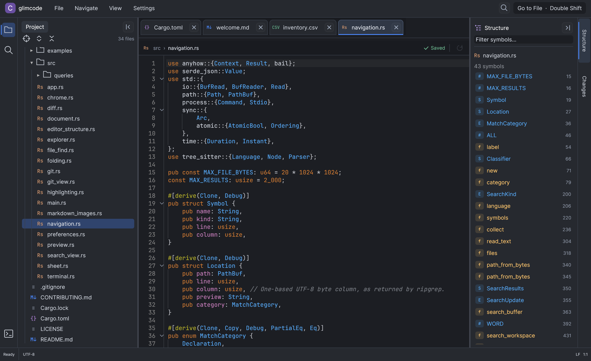
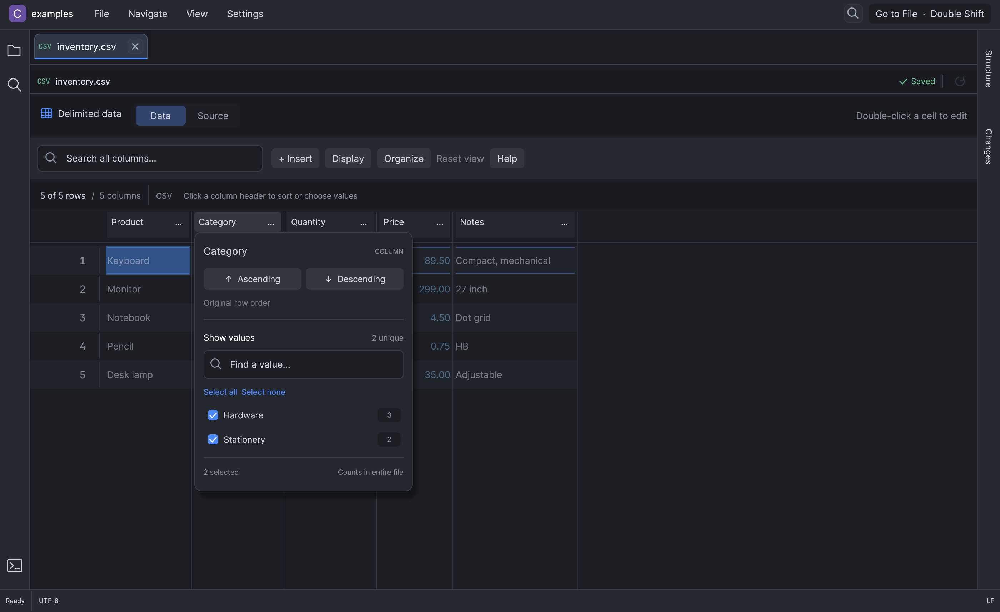

<div align="center">

# Glimcode

### A lightweight, IntelliJ-inspired editor for the AI coding era.

**Navigate code. Review agent changes. Keep your workspace lean.**

[](https://github.com/meavi1994/glimcode/actions/workflows/ci.yml)
[](LICENSE)
[](https://www.rust-lang.org/)

[Get started](#get-started) · [Features](#built-for-the-work-around-ai-generated-code) · [User guide](docs/USER_GUIDE.md) · [Contribute](#help-build-glimcode)

</div>

Glimcode is a native desktop code editor written in Rust. It brings familiar IntelliJ-style navigation, built-in syntax highlighting, Git review, a terminal, CSV editing, and Markdown preview into a focused workspace.

If an AI agent handles much of your typing, you still need to find the right file, understand the surrounding code, and inspect every change. Glimcode is built for that workflow: an IntelliJ alternative for developers who want familiar navigation with a smaller architectural footprint.



## Why Glimcode?

- **Native Rust UI.** Uses egui/eframe, without an Electron runtime, embedded browser UI, or JVM.
- **Navigation without language servers.** ripgrep handles project search; Tree-sitter supplies file structure and syntax-based definition candidates. No LSP setup or background language-server processes.
- **Familiar shortcuts.** Double Shift for files, Cmd/Ctrl-click for symbol search, Find in Files, a structure panel, and navigation history.
- **Highlighting built in.** Language-aware colors, folding, matching brackets, indentation guides, and a full-file search preview.
- **The tools beside your code.** Git diffs and blame, a native terminal, editable CSV/TSV grids, and Markdown previews.

The architecture is designed to keep memory overhead low. **We do not yet publish a measured RAM comparison with IntelliJ or a fixed memory-usage promise.** Usage depends on project size, open files, terminal sessions, and workload. Reproducible performance measurements and improvements are welcome.

## Built for the work around AI-generated code

| Task | What Glimcode provides |
| --- | --- |
| Find your way through a repository | Fast file search, recent files, outlines, syntax-based definition candidates, and text-based usage search |
| Read and understand changes | Syntax highlighting, folding, search previews, and navigation history |
| Review an agent’s work | Branch diffs, changed-file navigation, line change markers, and Git blame |
| Run your tools | Integrated pseudo-terminal with tabs, shell selection, clipboard support, and scrollback |
| Inspect generated data | CSV/TSV grid with sort menus, selectable unique values, counts, and Data / Source switching |
| Read project notes | Markdown Source, Split, and Preview modes with tables, images, and highlighted code blocks |

Use your preferred AI coding tool alongside Glimcode, or run a CLI tool in the integrated terminal. AI tools are installed separately; Glimcode currently has no built-in model integration or agent orchestration.

### Code navigation and highlighting

Tree-sitter navigation supports **Java, Kotlin, Go, Rust, Python, JavaScript/JSX, and TypeScript/TSX**. Syntax highlighting combines parser-based rules with Syntect’s bundled language definitions. Search can be narrowed to declarations, usages, strings, comments, imports, file extensions, open files, or the current file.

Definition jumps are syntax candidates and usages are text matches. Glimcode currently does **not** provide type-aware symbol resolution, code completion, semantic refactoring, debugging, or compiler diagnostics. Choose it for reading, navigating, editing, and reviewing code; use a full language IDE when you need those deeper capabilities.

### CSV editing that fits the workflow

Click anywhere in a column header to open its sort and value-selection menu. Choose multiple exact values, search the checklist, inspect occurrence counts, or return to the original row order. Switch to **Source** to edit raw CSV/TSV and back to **Data** to see the result.



Sorting and value selections change the view; hidden rows remain in saved files. Grid editing includes rectangular selection, copy/paste, undo/redo, resizable columns, and row actions. See the [user guide](docs/USER_GUIDE.md#csv-and-tsv-sheets) for editing and save behavior.

## Get started

Glimcode is currently distributed as source. Install a current stable [Rust toolchain](https://www.rust-lang.org/tools/install), [ripgrep](https://github.com/BurntSushi/ripgrep), and Git. The current desktop build has been exercised on **macOS Apple Silicon**; Linux and Windows support needs broader testing.

On macOS:

```sh
brew install rust ripgrep git
git clone https://github.com/meavi1994/glimcode.git
cd glimcode
cargo run --release -- /path/to/project
```

The optional argument can be a project directory or a file. Without one, Glimcode opens the current directory. You can also use **Open folder** and **Open file** inside the app.

To install the executable locally:

```sh
cargo install --path . --locked
glimcode /path/to/project
```

GitHub pull-request links and commit-to-PR lookup optionally use an authenticated [GitHub CLI](https://cli.github.com/). Local Git review works without it.

### Essential shortcuts

| Action | macOS | Windows / Linux |
| --- | --- | --- |
| Find a file | Shift twice | Shift twice |
| Find in Files | Cmd Shift F | Ctrl Shift F |
| File structure | Cmd F12 | Ctrl F12 |
| Definition candidates | Cmd B / F12 | Ctrl B / F12 |
| Find usages | Option F7 / Shift F12 | Alt F7 / Shift F12 |
| Find / replace | Cmd F / Cmd R | Ctrl F / Ctrl R |
| Go to line | Cmd L | Ctrl G |
| Save | Cmd S | Ctrl S |
| Terminal | Option F12 | Alt F12 |

See the [full user guide](docs/USER_GUIDE.md) for shortcuts, Git tools, terminal behavior, preferences, and file limits. Preferences currently retain the original development location, `~/.coder/settings.json`.

## Help build Glimcode

**You are welcome to open pull requests for new features, bug fixes, UI improvements, documentation, and performance work.** You do not need to wait for an invitation. Small contributions count.

- **Found a bug?** [Open an issue](https://github.com/meavi1994/glimcode/issues/new) with steps to reproduce, your OS, and expected versus actual behavior. A fix is welcome too.
- **Want a feature?** Open an issue or send a focused PR. For a substantial change, discuss the direction first so we can agree on scope.
- **Care about speed and memory?** Share reproducible measurements or a PR that improves a real workload.
- **Trying Linux or Windows?** Build reports, setup corrections, and platform fixes are especially useful.

Read [CONTRIBUTING.md](CONTRIBUTING.md) for setup and checks. This is an early project; feedback and practical contributions help shape it.

## Development

```sh
cargo fmt --check
cargo test --locked
cargo build --release --locked
```

Tests cover navigation, Unicode handling, search, highlighting, CSV round trips and UI interactions, saving, Git views, terminal behavior, and native layouts. Sample files live in [`examples/`](examples/).

The table integration is vendored with small local changes; see [`vendor/egui-data-table/PATCHES.md`](vendor/egui-data-table/PATCHES.md).

## Built with

[egui / eframe](https://github.com/emilk/egui) · [ripgrep](https://github.com/BurntSushi/ripgrep) · [Tree-sitter](https://tree-sitter.github.io/tree-sitter/) · [Syntect](https://github.com/trishume/syntect) · [egui-data-table](https://github.com/kang-sw/egui-data-table) · [egui_commonmark](https://github.com/lampsitter/egui_commonmark)

## License

[MIT](LICENSE). Vendored dependencies retain their own license notices.

IntelliJ IDEA is a JetBrains product. Glimcode is an independent project and is not affiliated with JetBrains.
