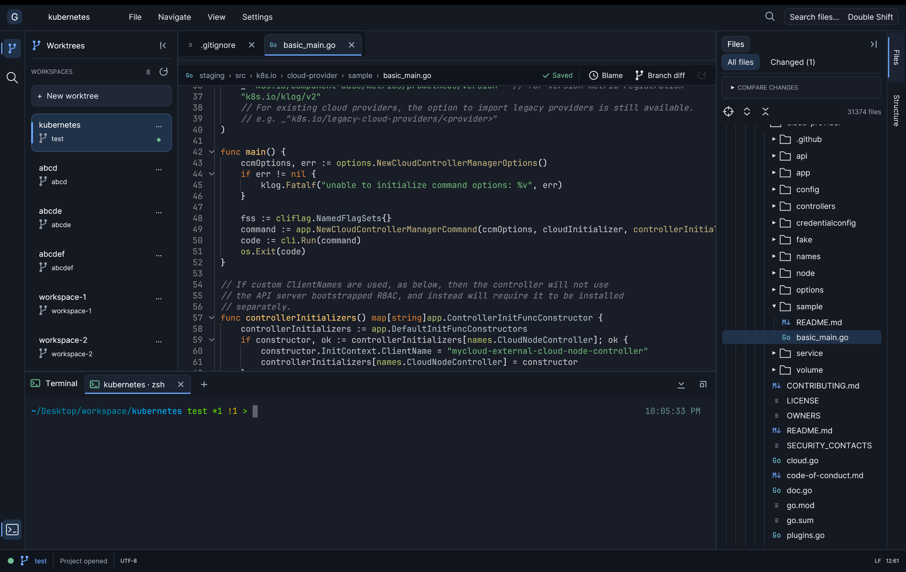
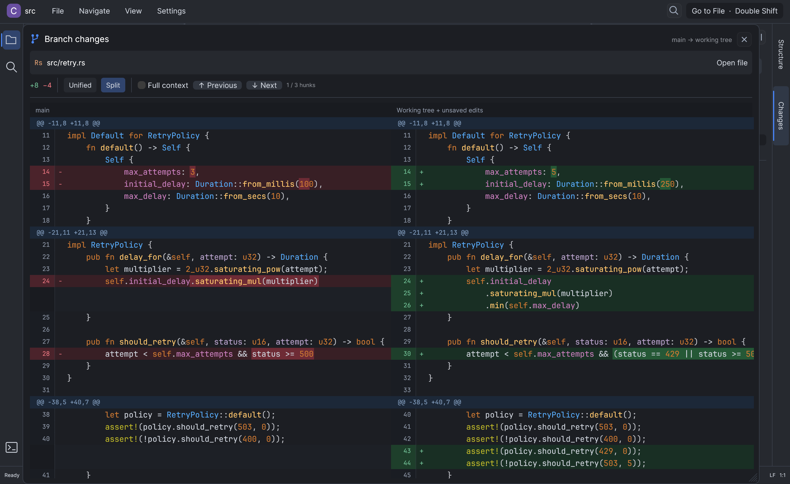

<div align="center">

# Glimcode

### A lightweight, IntelliJ-inspired editor for the AI coding era.

**Navigate code. Review agent changes. Keep your workspace lean.**

[](https://github.com/meavi1994/glimcode/actions/workflows/ci.yml)
[](LICENSE)
[](https://www.rust-lang.org/)

[Download for macOS](#download-for-macos) · [Get started](#get-started) · [Features](#built-for-the-work-around-ai-generated-code) · [User guide](docs/USER_GUIDE.md) · [Contribute](#help-build-glimcode)

</div>

Glimcode is a native desktop code editor written in Rust. It brings familiar IntelliJ-style navigation, built-in syntax highlighting, Git review, worktree management, tabbed terminals, CSV editing, and Markdown preview into a focused workspace.

If an AI agent handles much of your typing, you still need to find the right file, understand the surrounding code, and inspect every change. Glimcode is built for that workflow: an IntelliJ alternative for developers who want familiar navigation with a smaller architectural footprint.


## Why Glimcode?

- **Native Rust UI.** Uses egui/eframe, without an Electron runtime, embedded browser UI, or JVM.
- **Navigation without language servers.** Embedded ripgrep libraries handle project search; Tree-sitter supplies file structure and syntax-based definition candidates. No LSP setup, background language-server processes, or separate `rg` installation.
- **Familiar shortcuts.** Double Shift for files, Cmd/Ctrl-click for symbol search, Find in Files, a structure panel, and navigation history.
- **Highlighting built in.** Language-aware colors, folding, matching brackets, indentation guides, and a full-file search preview.
- **Multiple worktrees, one workspace.** Create, switch, and safely remove Git worktrees from the left panel, keeping each folder’s open files and live terminals when switching.
- **The tools beside your code.** Git diffs and blame, a native terminal, editable CSV/TSV grids, and Markdown previews.

Add shared ignore rules to `~/.glimcode/.gitignore` to filter the Changed files view and search across all projects, alongside each project’s local ignore rules. The file is created automatically on startup. All files remains available for browsing globally ignored paths.

Search uses the official `grep` library and `ignore` walker directly, with up to four background search workers, bounded result queues, and cancellation. It does not launch an external search process or parse command-line JSON output.

Result rows in **Find in Files** are syntax colored: every file behind the visible rows is highlighted once on a background worker, and each row shows the colors of the line it came from with the match marked. The editor keeps only one copy of a document in its own memory, the undo history of a large file is capped, and the files behind a click are read within a fixed byte budget, so a search or a jump does not grow the footprint without limit.

The same holds for the work a frame does: the syntax colors of a document are computed once per change and shared by the editor and the panels that show it, a search hands over only the buffers that changed, and a click does not copy the file it happens in.

The architecture is designed to keep memory overhead low. **We do not yet publish a measured RAM comparison with IntelliJ or a fixed memory-usage promise.** Usage depends on project size, open files, terminal sessions, and workload. Reproducible performance measurements and improvements are welcome.

## Built for the work around AI-generated code

| Task | What Glimcode provides |
| --- | --- |
| Find your way through a repository | Fast file search, recent files, outlines, syntax-based definition candidates, and text-based usage search |
| Read and understand changes | Syntax highlighting, folding, search previews, and navigation history |
| Review an agent’s work | Branch diffs, changed-file navigation, line change markers, and Git blame |
| Work on parallel branches | Create and switch Git worktrees with separate editor tabs, unsaved buffers, and terminal sessions |
| Run your tools | Integrated pseudo-terminal with tabs, shell selection, clipboard support, and scrollback |
| Inspect generated data | CSV/TSV grid with sort menus, selectable unique values, counts, and Data / Source switching |
| Read project notes | Markdown Source, Split, and Preview modes with tables, images, and highlighted code blocks |

Use your preferred AI coding tool alongside Glimcode, or run a CLI tool in the integrated terminal. AI tools are installed separately; Glimcode currently has no built-in model integration or agent orchestration.

### Code navigation and highlighting

Tree-sitter navigation supports **Java, Kotlin, Go, Rust, Python, JavaScript/JSX, and TypeScript/TSX**. Syntax highlighting combines parser-based rules with Syntect’s bundled language definitions. Search can be narrowed to declarations, usages, strings, comments, imports, file extensions, open files, or the current file.

Result rows in **Find in Files** carry the syntax colors of the file they come from, so a hit reads as code instead of as plain text. Cmd-click ranks the candidates: the same file and scope come first, then the type you are calling through, then imports and package, and never a mention inside a comment or a string. Code the user is not working in — vendored, generated or test files — comes last, unless the click happens inside such a file.

Definition jumps are syntax candidates and usages are text matches. Glimcode currently does **not** provide type-aware symbol resolution, code completion, semantic refactoring, debugging, or compiler diagnostics. Choose it for reading, navigating, editing, and reviewing code; use a full language IDE when you need those deeper capabilities.

### Git worktrees and saved workspaces



Use the left **Worktrees** panel to work on multiple branches in separate folders without repeatedly checking out branches in one directory. Each worktree keeps its open files, unsaved edits, navigation history, and running terminals while you switch within the app.

- **Create:** Click **New worktree** and enter a name. The branch defaults to that name, and the folder defaults to a sibling of the current project, such as `~/projects/my-feature` beside `~/projects/my-project`. Review or override the branch and folder before creating it.
- **Switch:** Click a worktree card to open its workspace. The right **Files** panel shows that folder’s files and Git changes; **Structure** shows the current file’s outline.
- **Remove:** Use a worktree’s `···` menu or right-click it to request deletion. Deletion requires confirmation; the main, active, locked, modified, and unsaved worktrees are protected.
- **Make room:** Collapse the Worktrees panel using its header arrow. Reopen it with the branch icon on the left rail or **View → Worktrees tool window**.

Folder sessions are saved under `~/.glimcode/projects/`. Reopening a folder restores its file tabs, active tab, cursor locations, panel visibility, and terminal tab metadata. On macOS and Linux, terminals use tmux when installed: shells and programs keep running after quitting Glimcode, and restored tabs reconnect on demand with their retained history. Install tmux on macOS with `brew install tmux`. Without tmux, tabs start fresh shells in their saved directories. Unsaved file contents are not restored after quitting.

See the [workspace panel guide](docs/USER_GUIDE.md#workspace-panels) and [session restore details](docs/USER_GUIDE.md#project-session-restore).

### GitHub-style branch review

Review changes in **Split** or **Unified** mode. Split view aligns old and new lines, highlights the changed text within replacements, and synchronizes vertical scrolling while each side can scroll horizontally. Compact gutters, hunk navigation, and a full-context toggle keep the code at the center of the review.



### CSV editing that fits the workflow

Click anywhere in a column header to open its sort and value-selection menu. Choose multiple exact values, search the checklist, inspect occurrence counts, or return to the original row order. Switch to **Source** to edit raw CSV/TSV and back to **Data** to see the result.


Sorting and value selections change the view; hidden rows remain in saved files. Grid editing includes rectangular selection, copy/paste, undo/redo, resizable columns, and row actions. See the [user guide](docs/USER_GUIDE.md#csv-and-tsv-sheets) for editing and save behavior.

## Get started

### Download for macOS

Prebuilt command-line executables are available on the [latest release page](https://github.com/meavi1994/glimcode/releases/latest). **Rust is not required** to run a downloaded binary. These builds require **macOS 15 (Sequoia) or later**.

| Your Mac | Download |
| --- | --- |
| Apple Silicon (M1 and later) | [glimcode-macos-arm64.tar.gz](https://github.com/meavi1994/glimcode/releases/latest/download/glimcode-macos-arm64.tar.gz) |
| Intel | [glimcode-macos-x86_64.tar.gz](https://github.com/meavi1994/glimcode/releases/latest/download/glimcode-macos-x86_64.tar.gz) |

Check **Apple menu → About This Mac** if you are unsure which processor you have. Download the matching archive and extract it, either by double-clicking it in Finder or from Terminal:

```sh
cd ~/Downloads
# Apple Silicon; for Intel, replace arm64 with x86_64 in both commands.
tar -xzf glimcode-macos-arm64.tar.gz
cd glimcode-macos-arm64
./glimcode /path/to/project
```

The executable inside the extracted folder is named **`glimcode`**. Install it in a stable location before adding it to your PATH:

```sh
mkdir -p "$HOME/.local/bin"
install -m 755 ./glimcode "$HOME/.local/bin/glimcode"
```

Follow [Add Glimcode to your PATH](#add-glimcode-to-your-path) below, then use `glimcode` from any directory.

Downloads include an ad-hoc code signature, but are **not Apple Developer ID signed or notarized**. If macOS blocks the first launch, attempt to run the binary, then open **System Settings → Privacy & Security → Open Anyway** if you trust the download. See [Apple's instructions](https://support.apple.com/en-us/102445).

The release also includes `SHA256SUMS`. To verify an Apple Silicon download, put that file beside the archive and run the following (substitute `x86_64` for Intel):

```sh
grep 'glimcode-macos-arm64.tar.gz$' SHA256SUMS | shasum -a 256 -c -
```

### Build from source

Install a current stable [Rust toolchain](https://www.rust-lang.org/tools/install). On macOS, you can use `brew install rust git`. Git is needed for version-control features. Linux and Windows support needs broader testing.

```sh
git clone https://github.com/meavi1994/glimcode.git
cd glimcode
cargo build --release --locked
```

**The compiled binary is `target/release/glimcode` inside the cloned repository** (`target/release/glimcode.exe` on Windows). Run it directly:

```sh
./target/release/glimcode /path/to/project
```

This is a standalone executable; you do not need `cargo run` or Rust to launch it afterward. If you set `CARGO_TARGET_DIR`, look in that directory's `release/` folder instead. An explicit `--target` build puts it in `target/<target-triple>/release/`.

To install the compiled binary in a stable location on macOS or Linux:

```sh
mkdir -p "$HOME/.local/bin"
install -m 755 target/release/glimcode "$HOME/.local/bin/glimcode"
```

Alternatively, `cargo install --path . --locked` builds and installs it into **`~/.cargo/bin/glimcode`** by default (`$CARGO_HOME/bin/glimcode` if customized). Rust installations usually add that directory to PATH already. Choose the PATH entry below that matches where you installed the binary.

### Add Glimcode to your PATH

For a downloaded or compiled binary installed in `~/.local/bin`, add this line **once** to your shell's configuration:

```sh
export PATH="$HOME/.local/bin:$PATH"
```

For **zsh** (the default on modern macOS), edit `~/.zshrc`, save it, and reload it:

```sh
nano ~/.zshrc
source ~/.zshrc
```

For **Bash**, edit `~/.bashrc`, save it, and reload it:

```sh
nano ~/.bashrc
source ~/.bashrc
```

If you used `cargo install`, add `export PATH="$HOME/.cargo/bin:$PATH"` instead (or your custom Cargo bin directory). You can also add the absolute path of the repository's `target/release` directory to PATH, but moving the repository or running `cargo clean` will remove access to that binary.

Bash login shells, including many macOS Terminal configurations, read `~/.bash_profile` instead of `~/.bashrc`. If your login shell does not already load `.bashrc`, add this line to `~/.bash_profile`:

```sh
[ -f "$HOME/.bashrc" ] && . "$HOME/.bashrc"
```

Open a new terminal or reload the appropriate file, then confirm that your shell finds the command:

```sh
command -v glimcode
# For the ~/.local/bin installation: /Users/your-name/.local/bin/glimcode
```

If you see `command not found`, check the installation location and reload the configuration for the shell you are actually using (`echo "$SHELL"`). Updating the binary later only requires running the `install` command again; the PATH entry stays the same.

### Use the binary

Glimcode opens a desktop window. Run it from Terminal with an optional project directory or file path:

```sh
glimcode                         # Open the current directory
glimcode .                       # Open the current directory explicitly
glimcode ~/projects/my-project   # Open a project folder
glimcode ~/projects/my-project/src/main.rs  # Open a file and its parent folder
glimcode "/path/with spaces/project"       # Quote paths containing spaces
glimcode /path/to/project &      # Keep using the terminal while the editor runs
```

Pass one path per launch. You can also use **File → Open folder** and **File → Open file** inside the app. If you have not configured PATH yet, replace `glimcode` in these examples with the executable's path, such as `./target/release/glimcode` or `"$HOME/.local/bin/glimcode"`.

GitHub pull-request links and commit-to-PR lookup optionally use an authenticated [GitHub CLI](https://cli.github.com/). Local Git review works without it.

### Essential shortcuts

| Action | macOS | Windows / Linux |
| --- | --- | --- |
| Find a file | Shift twice | Shift twice |
| Find in Files | Cmd Shift F | Ctrl Shift F |
| File structure | Cmd F12 | Ctrl F12 |
| Definition candidates | Cmd B / F12 | Ctrl B / F12 |
| Find usages | Option F7 / Shift F12 | Alt F7 / Shift F12 |
| Find / replace | Cmd F / Cmd R | Ctrl F / Ctrl R |
| Go to line | Cmd L | Ctrl G |
| Save | Cmd S | Ctrl S |
| Terminal | Option F12 | Alt F12 |

See the [full user guide](docs/USER_GUIDE.md) for shortcuts, Git tools, terminal behavior, preferences, and file limits. Preferences are stored in `~/.glimcode/settings.json`; existing `~/.coder/settings.json` preferences migrate automatically.

## Help build Glimcode

**You are welcome to open pull requests for new features, bug fixes, UI improvements, documentation, and performance work.** You do not need to wait for an invitation. Small contributions count.

- **Found a bug?** [Open an issue](https://github.com/meavi1994/glimcode/issues/new) with steps to reproduce, your OS, and expected versus actual behavior. A fix is welcome too.
- **Want a feature?** Open an issue or send a focused PR. For a substantial change, discuss the direction first so we can agree on scope.
- **Care about speed and memory?** Share reproducible measurements or a PR that improves a real workload.
- **Trying Linux or Windows?** Build reports, setup corrections, and platform fixes are especially useful.

Read [CONTRIBUTING.md](CONTRIBUTING.md) for setup and checks. This is an early project; feedback and practical contributions help shape it.

## Development

```sh
cargo fmt --check
cargo test --locked
cargo build --release --locked
```

Tests cover navigation, Unicode handling, search, highlighting, CSV round trips and UI interactions, saving, Git views, terminal behavior, and native layouts. Sample files live in [`examples/`](examples/).

The Markdown preview uses Comrak for parsing and native widgets for display; see [`vendor/egui_commonmark/PATCHES.md`](vendor/egui_commonmark/PATCHES.md) for the renderer adapter.

The table integration is vendored with small local changes; see [`vendor/egui-data-table/PATCHES.md`](vendor/egui-data-table/PATCHES.md).

## Built with

[egui / eframe](https://github.com/emilk/egui) · [ripgrep](https://github.com/BurntSushi/ripgrep) · [Tree-sitter](https://tree-sitter.github.io/tree-sitter/) · [Syntect](https://github.com/trishume/syntect) · [egui-data-table](https://github.com/kang-sw/egui-data-table) · [Comrak](https://github.com/kivikakk/comrak) · [egui_commonmark](https://github.com/lampsitter/egui_commonmark)

## License

[MIT](LICENSE). Vendored dependencies retain their own license notices.

IntelliJ IDEA is a JetBrains product. Glimcode is an independent project and is not affiliated with JetBrains.
