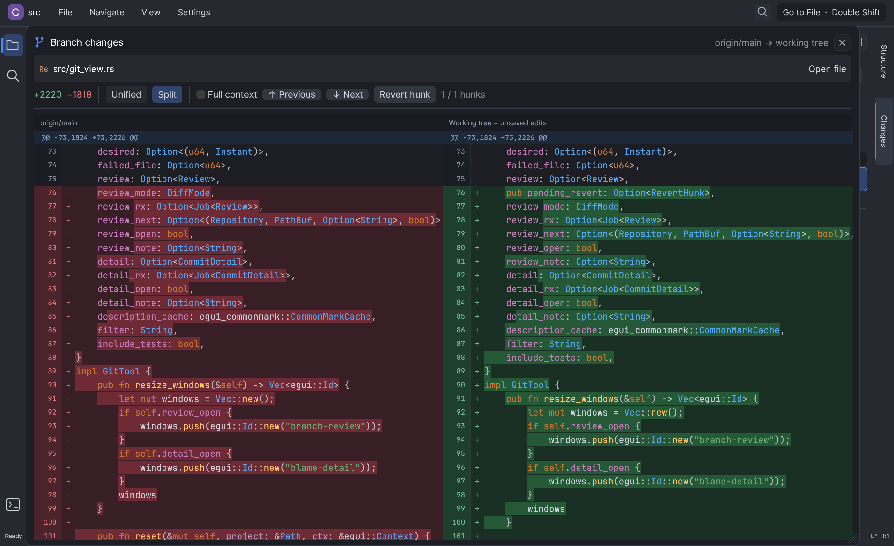

# Glimcode user guide

A native desktop IDE written in Rust. Code navigation uses **embedded ripgrep libraries and Tree-sitter**, with no LSP client or language-server process.

## Run

Download a prebuilt macOS executable or build from source using the [installation instructions](../README.md#get-started). They include binary locations, checksum verification, and PATH setup for `~/.zshrc` and `~/.bashrc`.

After installing the command:

```sh
glimcode                        # Open the current directory
glimcode /path/to/project       # Open a project
glimcode /path/to/project/file.rs  # Open a file and its parent folder
glimcode "/path/with spaces"    # Quote paths containing spaces
```

Without PATH setup, run the executable directly: `./target/release/glimcode /path/to/project` after a source build, or `./glimcode /path/to/project` from an extracted download. Source builds place the binary at `target/release/glimcode` by default. `cargo install --path . --locked` installs it at `~/.cargo/bin/glimcode` by default.

The app opens a desktop window. Pass one optional directory or file path per launch; without an argument, it opens the current directory. Use **Open folder** or **Open file** inside the app to navigate elsewhere. Install Git for version-control features; search is embedded and does not require a separate `rg` executable.

## Workspace panels

The left **Worktrees** panel lists the project's worktrees and provides create, switch, refresh, and delete controls. Click a branch to switch while keeping each worktree's open buffers and terminal sessions. Click **New worktree** to open the creation dialog. Enter a worktree name to fill in a matching branch and a sibling folder automatically: `<current-project-parent>/<worktree-name>`. Slashes in branch names become hyphens in the default folder name. All details are visible in the dialog. You can override the branch or folder; custom values are preserved while editing the worktree name. **Create worktree** shows progress and closes the dialog on success. Errors leave your inputs available to correct and retry; **Cancel** or **Escape** closes the dialog before creation begins. Right-click a worktree card to switch or delete it. Deletion requires confirmation; the main, active, locked, and modified worktrees are protected.

Collapse Worktrees with its header arrow and reopen it with the branch icon on the left rail or **View → Worktrees tool window**. Drag the panel edge to resize it.

The right-hand **Files** tab combines the project tree and Git changes. Choose **All files** to browse the project with Git status colors, or **Changed** to focus on changes, including deleted files. Right-click a changed file in either view to open its diff. Expand the branch comparison section for the base branch, pull request, and status legend. The Changed filter also supports hiding test files. **Reveal in Project** opens Files, selects All files, and reveals the selected file. **Structure** remains a separate right-hand tab. Click the active tab again or its header arrow to hide the panel.

## Code editor and navigation

- Collapsible project tree with folders first, file-name filtering, multiple tabs, navigation history, and go to line/column. Filtering reveals matching files with their parent folders; navigating to a file reveals it in the tree.
- IntelliJ-inspired Darcula and light syntax colors, line numbers, current-line shading, standard text selection and undo/redo.
- Double Shift opens a focused file search with no mode tabs. Recently chosen files appear first (up to 50 per session), followed by open files and project files. Enter `abcd.txt:23` or `abcd.txt:23:24` to jump directly to a line or line/column. The part of the term that is in a row is marked, so a path such as `src/app` marks the file name it found. Structure and text search remain available through their shortcuts and menus.
- Tree-sitter outlines and definition candidates for Java, Kotlin (`.kt`/`.kts`), Go, Rust, Python, JavaScript/JSX, TypeScript/TSX.
- Literal project search and whole-word reference matches through ripgrep’s embedded Rust search engine. Results open at the matching line and column, including Unicode text.
- Hold Cmd (Ctrl on Windows/Linux) to highlight and underline the word under the pointer with a link cursor; click to search. Cmd-click searches the token under the pointer, regardless of the previous caret position. Clicking whitespace does not search the previous word.
- Cmd-click on a declaration opens its usages, and Cmd-click on a usage opens the declaration. The candidates are then ranked: a declaration in the same file and scope wins over one in another package, a method of the type you are calling through wins over a same-named method elsewhere, a public API wins over a private one, and mentions inside comments and strings never win. Vendored, generated and test files come last, unless you are working in them yourself. The ranking is recomputed on every click, so it follows the code as it changes.
- Search results use mutually exclusive All, Declarations, Usages, Strings, Comments, Imports, and Other toggles, with counts. Each matched occurrence is classified at its syntax position: binding names are declarations, while references in type annotations, initializers, default values, and destructuring property keys remain usages. Different occurrences on one line can belong to different categories. This is syntax-based classification, not symbol or type resolution. Selecting one deselects the previous category. The extension dropdown lists only extensions present in the current results, including files without an extension. Category and extension filters combine locally without rerunning ripgrep.
- IntelliJ-inspired workspace with a compact menu bar, tool rail, file-type icons, blue active-tab underline, breadcrumbs, and a darker editor. Find in Files floats above the workspace with highlighted matches, keyboard selection, and a syntax-colored code preview; Dock moves it into a resizable bottom tool window.
- Find in Files gives most of its height to results. Drag the divider to change the results/preview split. Up/Down keeps the selected result visible and wraps at the ends; Enter or a double-click opens it. There is no footer action taking space from the list.
- Result rows are syntax colored, not plain text. Every file behind the visible rows is highlighted once in the background, and the row shows the colors of the line it came from, with the match marked. A row is never blank while the colors load, and rows use the monospaced editor font so the code lines up.
- The search preview includes the entire file, with virtualized scrolling and syntax colors that preserve multiline context. Selecting a result scrolls to its match once; manual scrolling remains free afterward. Result and preview areas keep their height even for short files or empty results. **Whole words** matches word boundaries (`generate()` and `build-generate`, but not `generated` or `generate_keys`); changing it reruns the search.
- **Exclude test files** is enabled by default in Find in Files. It skips the same filename/folder conventions as Changes for Cmd/Ctrl+Shift+F, Cmd/Ctrl-click, references, and definition searches, including open buffers and Git-changed files. Turn it off to include tests; changing it cancels and reruns the current search. Turning it off applies only to the current search. Each new submitted search, Cmd/Ctrl-click, reference/definition search, or reopening Find in Files restores exclusion. Changing **Whole words** keeps the current test selection. This toggle is independent of **Hide test files** in Changes.
- Editor tabs are searched first (active file first), using unsaved edits, followed by files in the Git Changes tree. These results are marked **Open**. Project matches then stream in from ripgrep, excluding files already searched. A new search cancels the previous one.
- File loading and preview highlighting run on a cancellable worker with a bounded preview cache. Category counts, file extensions and visible result indices are cached; switching categories does not do disk I/O or syntax parsing on the UI thread.
- Structure lives in a collapsible right-hand tool window. Use its vertical **Structure** tab or **View → Structure tool window**. Filter by symbol name or kind; click a symbol to navigate. The left sidebar stays dedicated to worktrees; files and Git changes share the right-hand Files tab.
- On macOS, the app uses installed Inter / JetBrains Mono fonts when available, with system fonts as fallback. JSON keys are purple, string values green, numbers blue, and boolean/null literals orange. Code has indentation guides and a right-margin guide.

- Syntax highlighting for the languages bundled with Syntect, plus parser-based Java, Kotlin, Go, Rust, Python, JavaScript, TypeScript, TSX and JSX highlighting. Shared colors distinguish types, parameters, fields, constants, namespaces, annotations, macros, built-ins and escapes where the grammar identifies them. Common extension aliases are recognized.
- Gutter arrows collapse and expand multiline bracket blocks, with clickable inline previews and original line numbers. Python and YAML also fold indentation blocks. Jumping or finding text inside a collapsed block reveals it; folding preserves the full source buffer and undo history.
- Continuous indentation guides span blank lines. Placing the caret before or after `{}`, `[]` or `()` highlights its matching pair, ignoring brackets in highlighted strings and comments.
- The terminal starts each shell with the size of the panel, so a right aligned prompt, such as a clock in the corner, is placed at the right edge instead of behind the prompt. A shell reads the size of the terminal once, when it starts, and keeps the prompt it built for that width.
- The project toolbar has **Select opened file**, **Expand all** and **Collapse all**. Switching project folders closes the previous tabs and clears navigation/search state; unsaved edits go through Save/Discard/Cancel first.
- Search has **Opened** and **Current** toggle buttons. Selecting one deselects the other; clicking the selected button clears it, and neither selected means all project files. **Opened** includes editor tabs and files in the Git Changes tree. Scope, category and extension filters combine; counts follow the selected scope.
- Selecting text highlights matching occurrences throughout the file. In-file search highlights every literal match and shows a match count while keeping syntax colors.
- **Reload from disk** refreshes the active editor from its saved file. It is disabled when contents match and asks before discarding unsaved edits.
- Active tabs, file breadcrumbs, and a saved/unsaved indicator make the current editing state visible. Undoing text back to the saved version clears the unsaved marker.
- Cmd/Ctrl+F opens a compact in-file search bar with a current/total counter and previous/next arrows. Up/Down and Shift+Enter/Enter navigate matches while the search field stays focused, wrapping at either end. The active match has a distinct highlight and scrolls into view. Escape closes search; Replace or Cmd/Ctrl+R reveals replace-all.
- Duplicate current line and toggle current-line comment.
- Save with external-change detection and atomic file replacement; unsaved changes prompt before closing a tab or exiting.

Definitions are syntax candidates and references are text matches, including comments and strings. Search reads open editor snapshots first and saved files elsewhere in the project; the current-file outline updates from the editor buffer. There is no type-aware resolution, completion, rename refactoring, or diagnostics. ripgrep honors ignore rules and skips `.git` and `target`. Search displays at most 2,000 results; editable files must be UTF-8, nonbinary, and at most 20 MiB.

### Large source files

Files with at least 10,000 newline characters or 512 KiB of text show editable text before full syntax analysis finishes. Syntax colors, folding, and indentation guides are prepared in a background worker and appear when ready. Editing postpones new analysis until input settles; results for an older buffer are discarded. Large-file render caches are released when their tabs stop being rendered.

Symbol outlines are also prepared in the background for large files. Git line markers and hunk counts are requested after drawing the editor, with a short idle delay when opening a file or typing. You can read and edit while those annotations load.

### Keyboard controls

| Action | macOS | Windows / Linux |
|---|---|---|
| Go to file | Shift twice | Shift twice |
| Go to file | Cmd Shift O | Ctrl Shift N |
| File structure | Cmd F12 | Ctrl F12 |
| Open / recent files | Cmd E | Ctrl E |
| Go to line (`line:byte-column`) | Cmd L | Ctrl G |
| Definition | Cmd B or F12 | Ctrl B or F12 |
| Find usages (text matches) | Option F7 or Shift F12 | Alt F7 or Shift F12 |
| Back | Cmd [ or Option Left | Alt Left |
| Find / replace in file | Cmd F / Cmd R | Ctrl F / Ctrl R |
| Find in Files | Cmd Shift F | Ctrl Shift F |
| Duplicate current line | Cmd D | Ctrl D |
| Toggle current-line comment | Cmd / | Ctrl / |
| Next / previous tab | Ctrl Tab / Ctrl Shift Tab | Ctrl Tab / Ctrl Shift Tab |
| Save | Cmd S | Ctrl S |
| Close tab | Cmd W | Ctrl W |

These are a practical subset of IntelliJ-style controls. Duplicate and comment act on the current line. The recent-files popup lists recent search choices and currently open files. File pickers use case-insensitive substring matching.

## CSV and TSV sheets

Powered by [egui-data-table](https://github.com/kang-sw/egui-data-table) and the [csv crate](https://docs.rs/csv/).

- **Data / Source** switches between the grid and the full text editor. Edits sync both ways; switching alone preserves original quoting and line endings. Invalid source stays editable with an inline error when returning to Data. Source mode supports the normal find/replace and save controls.
- Editable cells, keyboard navigation, rectangular selection, system clipboard copy/paste in TSV format, and undo/redo for grid edits.
- A compact Data toolbar, resizable columns, striped rows and blue selection. Numeric and boolean values have distinct colors.
- **Display** controls compact row density, wrapped text, single-click editing and a full-value inspector for the selected cell. Truncated cells also expose their full value on hover.
- Search all columns from the toolbar. Click anywhere in a column header (its name or **...**) to open a single menu offering ascending/descending sorting and a searchable checklist of exact unique values with occurrence counts, including blanks. Select several values, select all/none, or clear individual selections above the grid. **Reset view** clears search, selections and sorting. Header editing and persistent row sorting live under **Organize**.
- Comfortable rows by default, content-sized columns (sampled from up to 200 rows), right-aligned numbers, numeric-aware sorting, and case-insensitive global search. Value selections combine with OR within a column and AND across columns; counts reflect the entire file.
- CSV import detects comma, semicolon, tab and pipe separators using parsed records; TSV files keep their tab separator. The detected delimiter is preserved on save.
- Resizable/reorderable/hideable columns, row duplication/removal through the context menu, add rows/columns, edit headers.
- Quoted commas, embedded newlines, Unicode, and TSV delimiters round-trip through the CSV parser.
- First row is treated as headers by default. Change **CSV import** before opening a headerless file. Files with inconsistent field counts report an error.

Double-click a cell or press Enter to edit. Tab commits and moves to the next cell; Escape commits the edit. Ctrl/Cmd Escape cancels an edit. Right-click for row and clipboard actions.

**Column headers open a unified sort and value-selection menu.** Ascending, descending and original row order change only the view. To write a new row order to disk, choose a column under **Organize → Reorder rows in saved file**, then **Ascending** or **Descending**, and save. Search and value selections never drop hidden rows from a saved file. Numeric cells sort before text cells. Grid edits normalize CSV formatting when saved; untouched data and source-only edits preserve exact quoting and line endings. Field values and the delimiter are preserved. Adding columns resets the grid's cell-edit undo history; header changes and explicit row-order changes are outside that history.

This edits CSV/TSV data, with no XLSX workbook or formula-calculation support.

## Markdown

[Comrak](https://github.com/kivikakk/comrak) parses CommonMark and GitHub-flavored Markdown, with [egui_commonmark](https://github.com/lampsitter/egui_commonmark) drawing the native preview. The preview supports headings, tables, task lists, strikethrough, lists, blockquotes, reference links, autolinks, footnotes, and fenced code blocks with highlighting. Switch between **Source**, **Split**, and **Preview**. Preview has larger headings, a padded reading area, blue links, and paragraph spacing. Local image paths resolve relative to the document; HTTP(S) images, PNG/JPEG files, SVG logos and extensionless SVG badges are supported. Inert HTML `` tags support `src`, `alt`, and numeric `width`. Other embedded HTML is omitted and scripts are never executed. Preview uses native widgets rather than GitHub's exact CSS.

## Preferences

Open **Settings → Preferences** to set independent **Editor**, **Dialogs**, **Terminal**, **Search results**, and **Search filters** font sizes (8–40 pt; all default to 14 pt). Search results controls matching text, file names, and line numbers. Search filters controls All / Declarations / Usages and the other category, scope, and file-type controls. Dialogs controls window labels, text fields, buttons, and headings; headings retain a larger size. Save applies changes immediately to open views and existing terminal sessions. Search result row heights adapt to their font size, including keyboard scrolling. Code previews and diffs keep using the Editor size. Existing saved sizes are preserved, and older settings files use 14 pt for the newly added controls.

Font and terminal preferences are stored in `~/.glimcode/settings.json`, including `editor_font_size`, `dialog_font_size`, `terminal_font_size`, `search_results_font_size`, `search_filters_font_size`, `shell` and `tab_name`. The file is created with defaults on first launch. Previous terminal preferences are migrated automatically when this file does not yet exist; the old file is retained. Additional JSON keys are preserved when saving. Manual changes are loaded on restart.

## Global ignore rules

Glimcode creates `~/.glimcode/.gitignore` on startup. Add standard `.gitignore` patterns there to exclude files and folders from the Changed files view and search (including open buffers and Git-changed files) in every project:

```gitignore
*.log
.cache/
generated/
```

These rules supplement each project's ignore files. Project `.gitignore`, `.ignore`, and `.rgignore` rules take precedence, including `!` exceptions. Patterns starting with `/` are anchored to each project's root. The global rules also apply to folders without a Git repository. File lists refresh automatically after edits; new searches read the latest rules. Existing global rules are preserved when Glimcode starts. The full **All files** tree keeps globally ignored files and folders visible; project-local ignore rules still apply to that tree.

## Terminal

Open the bottom terminal using the left rail’s terminal icon, **View → Terminal**, **Alt F12**, or **Cmd/Ctrl + backtick**. The terminal extends beneath the left Worktrees panel, while the right Files/Structure panel keeps its full height. Drag its top edge to resize it. Click **Maximize terminal** in the terminal header to replace the file tabs with terminal tabs in the editor area. **Restore terminal panel** returns to the bottom panel with the previous panel height and open files intact. Both layouts use the same running shells, and the layout choice is saved per project. **+** or **Cmd/Ctrl+T** (while the terminal has focus) starts an independent shell in the current project directory, even if another terminal has changed directories. Hiding the panel keeps its sessions running; closing a live tab with its close button or **Cmd/Ctrl+W** ends that session after confirmation. Existing sessions retain their directory when switching projects; new tabs use the new project.

Use **Settings → Preferences** to select a shell executable (with optional arguments) and an optional default tab name. Preferences are saved in `~/.glimcode/settings.json`. Shell and tab-name settings apply to new sessions. Automatic names combine project and shell, adopt shell-provided titles/current directories, and add `(2)`, `(3)` for duplicates. A custom default name overrides automatic naming.

The terminal uses a native pseudo-terminal with ANSI colors, cursor positioning, alternate screens, scrollback, shell history, Tab completion, Ctrl+C/Ctrl+D and bracketed paste. Scroll with the mouse wheel, drag to select text, or double-click to select a word or complete file path (including slashes, dots and hyphens). Selection follows paths across wrapped lines and stops at whitespace, quotes and shell separators. Hovering over terminal content shows the text-selection cursor. Use Cmd+C on macOS or Ctrl+Shift+C elsewhere to copy. Paste with Cmd/Ctrl+V or the context menu. The context menu also copies visible output and returns to the bottom. Shell input and output run in background workers with bounded queues and scrollback.

Hold **Cmd** on macOS or **Ctrl** on Windows/Linux and click a URL, file path, or folder path in terminal output. Links show a pointer and underline while the modifier is held. HTTP/HTTPS URLs open in the browser; `www.` addresses such as `www.google.com` open using HTTPS. Files open directly when resolved; unresolved or ambiguous paths open the file search dialog with the path prefilled. Absolute paths and `~/` paths are supported. Relative paths are checked against the shell-reported directory (or the terminal's launch directory), its ancestors within the project, and the project root; project-name prefixes, Git's `a/` and `b/` prefixes, and unique project path suffixes are also recognized. Folders inside the project are revealed in Files; external folders open as projects in a new Glimcode instance. Trailing commas and periods are ignored. A location such as `src/main.rs:42:43` or `src/main.rs:42-7` uses only `src/main.rs:42` and navigates to the start of line 42.

## Git changes and blame

Open the right-hand **Files** tab and select **Changed**. Expand the branch comparison section to select a base or view pull request information. The tree compares the current branch, index, working files and unsaved editor buffers against the merge base of the selected base branch. The default is `origin/main`, then `origin/master`, with local branch fallbacks. Select another base from the dropdown; Refresh updates both changes and PR information.

Enable **Hide test files** below the filename filter to hide common test paths, including unsaved and deleted test files. It starts enabled and applies together with the text filter. The count shows visible files out of all changes and the number of test files hidden. Toggle it off to restore them. Refresh keeps the selection; switching projects or restarting restores the enabled default.

Detection uses repository-relative paths and explicit conventions, rather than any occurrence of `test` (which would also hide `Contest.java` and `Latest.cs`):

| Language / layout | Recognized patterns |
| --- | --- |
| Shared test folders (any language) | Exact folder names `test`, `tests`, `__tests__`, `spec`, `specs`, `__snapshots__`, `testdata`, `testFixtures`, `integrationTest`, `integrationTests`, `integration_test`, `integration_tests`, `e2e` (case insensitive). All contents, including helpers and fixtures, are hidden. |
| Go | `*_test.go` ([Go testing](https://go.dev/doc/tutorial/add-a-test)) |
| Python | `test_*.py`, `*_test.py`, `conftest.py` ([pytest discovery](https://pytest.org/en/stable/explanation/goodpractices.html)) |
| JavaScript / TypeScript | Dot-separated `test`, `spec`, or `cy` in the filename stem, e.g. `widget.test.tsx`, `widget.spec.mts`, `widget.cy.js`, `widget.test.d.ts`; also Vue/Svelte files ([Jest conventions](https://jestjs.io/docs/configuration#testmatch-arraystring)) |
| Java / Kotlin / Scala / Groovy, C# / F# / VB, Swift, PHP | `Test*` followed by an uppercase letter or underscore, or names ending in `Test`, `Tests`, `TestCase`, `Spec`; e.g. `TestWidget.java`, `WidgetTests.cs`. These CamelCase markers are case sensitive ([Surefire conventions](https://maven.apache.org/surefire/maven-surefire-plugin/examples/inclusion-exclusion.html)). |
| JVM / Android source sets | Exact folders `androidTest`, `commonTest`, `jvmTest`, `jsTest`, `nativeTest`, `iosTest`, in addition to shared folders |
| .NET / Swift test projects | Folders ending in `.Tests`, `.UnitTests`, `.IntegrationTests`, `.UITests` (case insensitive), or `Tests` (case sensitive), e.g. `App.Tests`, `AppTests` |
| Ruby | `test_*.rb`, `*_test.rb`, `*_spec.rb` |
| Dart / Flutter, Elixir | `*_test.dart`, `*_test.ex`, `*_test.exs` |
| Rust, C / C++, Objective-C | `test`, `tests`, `test_*`, `*_test`, `*_tests` filename stems, plus the CamelCase patterns above; source and header extensions |

This is a filename heuristic, not framework discovery. Custom paths configured in build files or test runners may be missed. Files containing both production code and inline tests (for example Rust `#[cfg(test)]` modules or doctests) remain visible unless their path matches. No project code is read or executed to classify files. Production files stored inside a recognized test folder are hidden too.

Both the All files and Changed views use green for committed branch changes, amber for uncommitted changes (including unsaved editor buffers), and red for deleted files. Files without branch or working-tree changes keep the normal text color in Project. Selecting a file preserves its Git status color. Badges distinguish committed (`C`), working (`W`), combined (`C+W`), deleted (`D`) and conflicted (`!`) states. Click a file to open it in the editor. The Changed tree shares the regular file tree’s right-click actions: **Copy file name**, **Copy absolute path**, **Copy path from content root**, **Rename…**, and **Delete file…**. Folder menus also offer **New file…**. Rename and delete use the standard dialogs; missing files keep their copy/diff actions with filesystem changes disabled. Right-click **View diff** (also available for deleted files), or use the editor’s **Branch diff** button, for a GitHub-style review with **Split** and **Unified** modes. Split is the default and aligns old/new replacement blocks, including empty placeholders for uneven additions and deletions. It synchronizes vertical scrolling while each side can scroll horizontally. Changed text within paired lines has stronger highlighting. Compact line-number gutters, **Previous / Next** change controls, **Full context**, and a right-click **Copy line** action support review. Drag across text to select it, then use **Cmd+C / Ctrl+C** or right-click **Copy selection**. Selection works across lines in either layout and copies source text without gutters or diff markers. Click a **double-chevron arrow** in the center gutter (or at the right edge in Unified mode) to apply that contiguous change block from the selected base to the working file as an unsaved change. The diff stays open and refreshes in place, retaining its scroll position and context mode. After applying the last change, it shows that no changes remain. Click **Undo applied change** or press **Cmd/Ctrl+Z** while the diff is open to undo applied changes in reverse order, including after applying the last change. Undo refreshes the diff in place and keeps edits unsaved. The diff’s undo history belongs to the current review; editor undo is also available. If the buffer has changed since the diff opened, reopen the diff before reverting. Each contiguous change block has its own arrow and navigation target, even when nearby edits share one Git-style context header. Navigation uses your current scroll position. The arrows remain available with a single change or at either end so you can return to changes after scrolling away, including in Full context. Renames retain the original baseline. **Open in editor** opens the current file.



Editor gutters show added lines in green, modified lines in blue and deletion anchors in red. Enable **Blame** above the editor for grouped commit annotations. Consecutive lines from a commit share one author/date heading and a short summary; the heading reappears when scrolling into a group. Every annotation row remains clickable for commit and PR details. Hovering a line or its annotation highlights the corresponding code line. Unsaved lines are identified as uncommitted.

Git runs in background workers. PR discovery uses the installed, authenticated GitHub CLI (`gh api`) and the repository’s `origin` remote, including GitHub Enterprise hosts. The Changes panel links to the open PR for the current branch; commit dialogs look up PRs associated with the selected commit. Git operations are read-only and use local refs; refresh remote refs externally when needed.

## Development

```sh
cargo test
cargo clippy --all-targets -- -D warnings
cargo fmt --check
cargo build --release
```

The tests cover CSV round trips, filtering, mixed numeric sorting, Unicode navigation, embedded ripgrep searches, Tree-sitter outlines, save-conflict protection, highlighting colors, and native-widget layout. The repository includes sample files under `examples/`.

Rust UI: [eframe / egui](https://github.com/emilk/egui). Parsing: [Tree-sitter](https://tree-sitter.github.io/tree-sitter/). Highlighting: [Syntect](https://github.com/trishume/syntect). Library versions are locked in `Cargo.lock`.

Right-click a project file to copy its name, absolute path, or path from the content root, rename it, or delete it after confirmation. Right-click a folder (including the project root) to create a named file. Folders can also be renamed. Existing names are never overwritten.

The Project tree refreshes in the background about every two seconds, so files and folders created, renamed, or removed by other tools appear automatically. Existing folder expansion is preserved, and project ignore rules still apply.

Disk changes to the active file are checked twice a second. When there are no unsaved edits, the editor automatically reloads the changed file while preserving the cursor and Source / Split / Preview mode. Unsaved edits are kept. **Reload from disk** lets you reload manually and asks before discarding unsaved edits. If a disk file cannot be loaded, the existing buffer is kept.

The file toolbar keeps the breadcrumb on the left and groups save status, Blame, branch diff, and reload controls on the right. It switches to icon controls in narrow editors. Right-click the breadcrumb to copy its name or path, or reveal it in Project. External disk changes have a distinct status.

## Project session restore

Glimcode stores preferences in `~/.glimcode/settings.json`, the last opened folder in `~/.glimcode/state.json`, and a small JSON session per canonical folder path in `~/.glimcode/projects/`. Worktrees are folders and use the same format. Existing `~/.coder/settings.json` preferences migrate automatically; the old file is retained.

Reopening a folder restores file tabs, their order, the active tab, cursor locations, panel visibility, and the changed-files scope. Missing files and invalid session data are skipped. Starting without a folder argument reopens the last folder.

Terminal tabs restore their active selection, visibility, and shell-reported working directories (falling back to their launch directories). They start fresh shells only when the terminal is shown; commands and running processes are not replayed after restart. Switching worktrees within the running app retains live shells and unsaved editor buffers. Unsaved file contents and terminal scrollback are not persisted.

Session metadata is saved atomically on folder switches and normal app shutdown. This is session restore, not crash recovery for unsaved edits.

The Worktrees panel lists folders first and branches beneath them, with active and unsaved indicators. Use the `···` action menu to switch workspaces, copy their folder path, or request safe deletion. **New worktree** stays above the scrolling list; the main, locked, active, and unsaved worktrees cannot be deleted through the menu.

In **Files**, **COMPARE CHANGES** starts collapsed to leave room for the file tree. Expand it to select the comparison branch, search available branches, or view comparison details. Long branch names have full-name tooltips.
